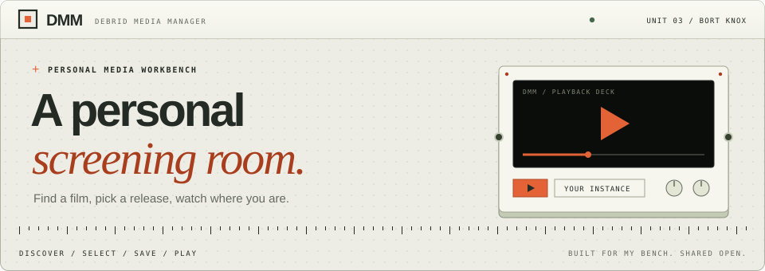
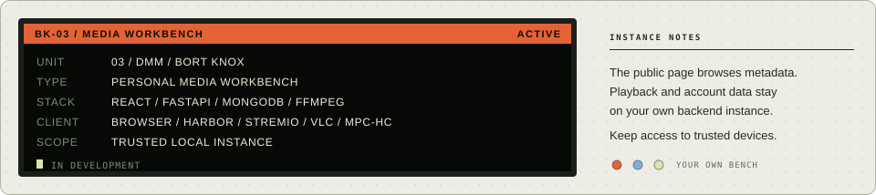
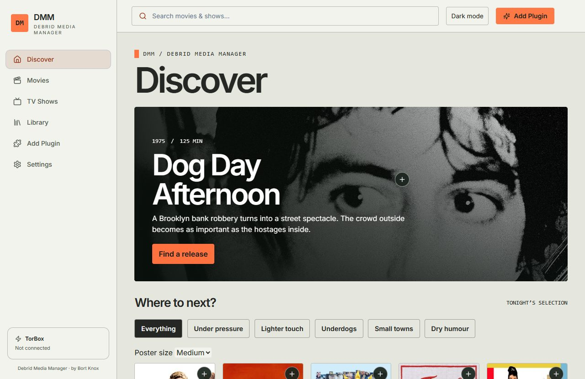

# DMM / DEBRID MEDIA MANAGER

**Find a film, pick a release, and watch it where you are.** I built DMM for the evenings I use Harbor on the media center and the ones when all I have is a browser.

[**Project preview & public catalogue**](https://bortknox.github.io/DMM/) · [**Run locally**](#run-it) · [**Playback field notes**](docs/FIELD-NOTES.md) · [**Personal remote access**](docs/REMOTE-ACCESS.md)



**Status.** Active development on `feature/discovery-desk`. The Pages site is a static project preview with public Cinemeta browsing and search. Run your own instance for saved titles, TorBox actions, add-on installation and server conversion.



## WHAT THIS IS

A personal TorBox front end with a discovery desk, movie and TV search, saved titles, release selection and an in-site player. The light bench interface and dark mode belong to the same workbench. Harbor and Stremio can use the backend as an add-on; VLC and MPC-HC can play its temporary file links.

I keep the catalogue, release choice and playback controls together so I can use the same instance from a browser or the media center. React handles the interface, FastAPI connects the services, MongoDB keeps instance settings and saves, and optional FFmpeg handles browser conversion.

> **Local first.** This build has shared settings and saves, without app authentication or per-user isolation. Keep it on trusted devices. It is not ready for public multi-user hosting.

## WHAT IT DOES

- **Discover and browse.** The discovery desk starts with an editorial film selection and tag-based suggestions. Browse movies and TV, search titles and explore seasons through keyless Cinemeta, or choose TMDB after adding its key in Settings.
- **Choose a release.** Search selected sources from seven supported indexer adapters. DMM merges duplicate hashes and checks TorBox availability. Sort and filter the returned releases by match, seeders, size, resolution and other source controls. Browser and add-on source coverage can differ.
- **Keep a library.** Save a title before choosing a release, or save a particular release and episode. **Saved in DMM** stays in your instance database. The separate **TorBox downloads** tab reads your account and offers playback and deletion there.
- **Cache and play.** Submit an uncached release to TorBox, then play it when available. The season action chooses a result per episode, handles up to 30 episodes and can skip unavailable results. Cached playback opens the embedded player; manual server conversion is available when the browser cannot play the original tracks.
- **Use your player.** Configure sources, resolution, size limits and cached-only results for each Harbor or Stremio installation. The chain-link control beside Copy magnet resolves a temporary file URL for VLC's Open Network Stream or MPC-HC's Open File. A separate device needs a reachable backend address.
- **Connect your own services.** TorBox is the implemented debrid provider. TMDB is optional; OMDb ratings, Fanart.tv logos and RPDB posters enrich the TMDB metadata path. TheTVDB currently has a credential test only. Enter keys in Settings; none ship with the code.

Playing or resolving a release can add it to TorBox. Saving it in DMM does not. Temporary playback links expire, and browser codec support varies. The [field notes](docs/FIELD-NOTES.md) explain those boundaries and the reported playback checks.

## RUN IT

You need Python 3, Node.js with **Yarn Classic 1.22.22**, and MongoDB installed and running. Use a virtual environment for the backend. Optional server conversion needs both `ffmpeg` and `ffprobe` on the backend host's path.

### Windows / PowerShell

Start MongoDB separately, then run:

```powershell
git clone --branch feature/discovery-desk https://github.com/BortKnox/DMM.git
cd DMM/backend
python -m venv .venv
.\.venv\Scripts\Activate.ps1
python -m pip install fastapi uvicorn httpx motor python-dotenv "pydantic>=2,<3"
$env:MONGO_URL = "mongodb://127.0.0.1:27017"
$env:DB_NAME = "dmm"
python -m uvicorn server:app --host 127.0.0.1 --port 8000 --reload
```

In a second terminal, from the clone root:

```powershell
cd frontend
yarn install
$env:REACT_APP_BACKEND_URL = "http://localhost:8000"
yarn start
```

<details>
<summary><strong>macOS / Linux shell commands</strong></summary>

Start MongoDB separately, then run:

```bash
git clone --branch feature/discovery-desk https://github.com/BortKnox/DMM.git
cd DMM/backend
python3 -m venv .venv
source .venv/bin/activate
python -m pip install fastapi uvicorn httpx motor python-dotenv 'pydantic>=2,<3'
MONGO_URL=mongodb://127.0.0.1:27017 DB_NAME=dmm \
  python -m uvicorn server:app --host 127.0.0.1 --port 8000 --reload
```

In a second terminal, from the clone root:

```bash
cd frontend
yarn install
REACT_APP_BACKEND_URL=http://localhost:8000 yarn start
```

</details>

Open the app at <http://localhost:3000> and the API docs at <http://localhost:8000/docs>. Add your TorBox key in Settings for account actions; Cinemeta browsing needs no catalogue key. These are development commands for a trusted local instance.

For your own phone or media center, use the [private remote-access recipe](docs/REMOTE-ACCESS.md). The frontend needs the explicit backend origin above during development; a production build can use same-origin `/api` behind a reverse proxy.

## FIELD NOTES

[**Playback, library and credentials**](docs/FIELD-NOTES.md) covers direct versus converted playback, saved records versus TorBox entries, metadata coverage and installation-link privacy. The recorded checks are observations on specific releases, not a universal playback guarantee.

[**Personal remote access**](docs/REMOTE-ACCESS.md) keeps the optional Tailscale and Caddy setup separate from the base install. Your backend PC still provides the bandwidth and conversion CPU.

## LAYOUT

```text
assets/readme/             # workshop banner, readout and footer; editable SVG
backend/server.py          # FastAPI application and /api routes
backend/cinemeta.py        # keyless catalogue integration
backend/tests/             # API test suites
frontend/src/pages/        # Discover, browse, detail, library, search and settings
frontend/src/components/   # layout, media cards, player and source controls
frontend/src/lib/api.js    # backend origin and API requests
docs/                      # public Pages preview, catalogue and field notes
memory/PRD.md              # product notes and iteration history
```

## NOTES FROM THE BENCH

`server.py` is still one large file; splitting it into routers is on the list. Trakt sync and AI search are planned, not built. Source indexers are third-party sites that change, so an adapter can stop returning useful results.

Provider keys live in your MongoDB configuration as readable values. The disconnect control clears the main provider-key fields; it is not a complete erase of installation records, backups or old links. Keep the database and private add-on URLs within your trusted setup.

You are responsible for the services you connect and the content you access. DMM does not include a media catalogue of files or make paid provider access free.

**Policy.** Built for my own bench first, and public so you can read it, fork it or borrow from it. I do not run it as a service. Issues and pull requests may sit unanswered; forking is welcome.

[**Back to the workshop**](https://github.com/BortKnox) · [**COWON A2 / TE Bench**](https://github.com/BortKnox/Cowon-a2-transformation-demo) · [**OmniRoute Field Station**](https://github.com/BortKnox/omniroute-field-station)


